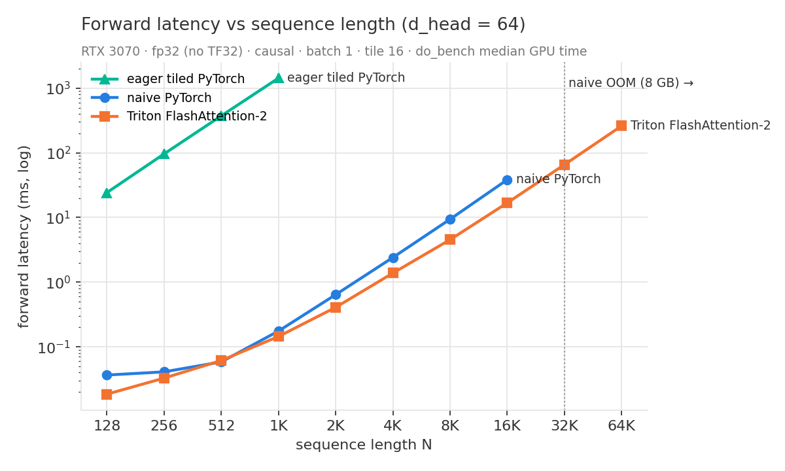
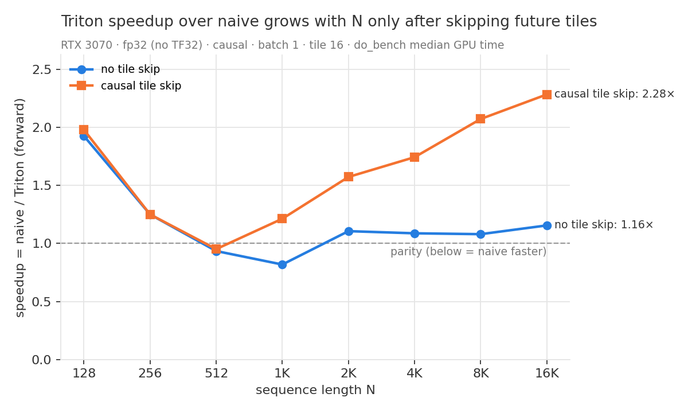
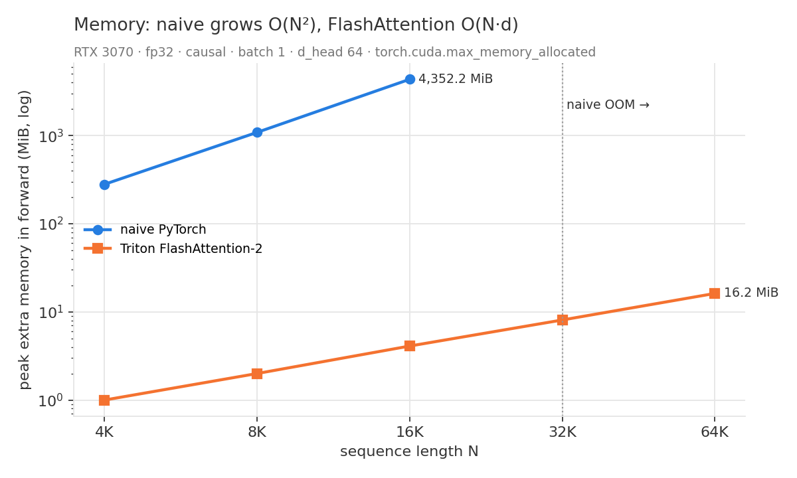
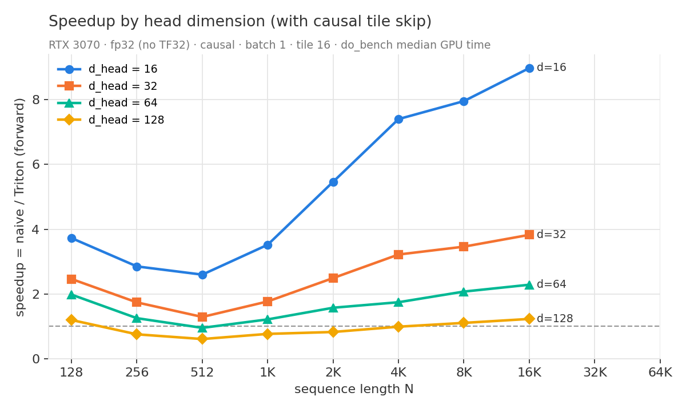

# CS336 Assignment 2 — Nsight Systems Profiling (Draft)

> **Status:** Profiling experiments completed; final report and per-configuration comparisons pending. These notes capture preliminary observations, not a finalized benchmark report.

## 1. Benchmarking vs. Profiling Overhead

I compared the forward-pass runtime of my PyTorch Transformer under three measurement configurations:

| Measurement | Approximate forward runtime |
| --- | ---: |
| Python timing with `torch.cuda.synchronize()` | 14 ms |
| Nsight Systems, lightweight tracing (`cuda,nvtx`) | 19 ms |
| Nsight Systems, extensive tracing | 40 ms |

The substantial reduction from 40 ms to 19 ms after disabling additional tracing suggests that **profiling instrumentation contributed significantly to the discrepancy**. Warmup reduces initialization-related effects, but does not remove tracing overhead during measurement.

**Takeaway:** Use synchronized Python timing as a baseline for end-to-end runtime. Use Nsight Systems to investigate CUDA API activity, kernel launches, and GPU execution. Ensure the compared measurements use equivalent scopes and configurations.

## 2. Forward-Pass CUDA Kernel Breakdown

In one profiling report, the `CUDA GPU Kernel Summary` showed:

| CUDA kernel | Total GPU kernel time | Instances | Share of reported GPU kernel time |
| --- | ---: | ---: | ---: |
| `ampere_sgemm_128x64_tn` | 36.76 ms | 296 | 44.8% |
| `ampere_sgemm_128x32_tn` | 17.94 ms | 384 | 21.9% |
| `ampere_sgemm_128x128_nn` | 3.34 ms | 96 | 4.1% |
| `ampere_sgemm_128x128_tn` | 2.26 ms | 96 | 2.7% |
| Largest `vectorized_elementwise_kernel` entry | 4.16 ms | 192 | 5.1% |

`sgemm` denotes single-precision general matrix multiplication (GEMM). The `128x64` and `128x32` portions identify aspects of the cuBLAS kernel's tiling strategy; they are **not** the dimensions of the model's weight matrices.

The two most expensive GEMM kernel types together accounted for **66.7% of the summed GPU kernel execution time in this report**. This percentage is not a share of end-to-end wall-clock runtime. The instance counts above cover the **entire captured report**, not one forward pass, so they should not be reported as per-forward invocation counts.

## 3. Why FLOPs Do Not Directly Predict Runtime

**Core lesson: Fewer FLOPs do not necessarily mean faster execution.**

The time required by a GPU operation depends not only on its floating-point operation count but also on memory traffic, achievable compute throughput, reductions, launch overhead, and opportunities for fusion.

### Self-attention: Softmax vs. matrix multiplication

For scaled dot-product attention:

\[
S = QK^T / \sqrt{d_k}, \qquad P = \operatorname{softmax}(S), \qquad O = PV.
\]

The two matrix multiplications (`QK^T` and `PV`) perform substantially more FLOPs than Softmax, but my **synchronized operation-level measurements** suggested that attention-score computation and Softmax took surprisingly similar amounts of time in the tested configuration.

A numerically stable Softmax includes a row-wise maximum, subtraction, exponentiation, row-wise sum, and normalization. In an unfused PyTorch implementation, these steps may require multiple elementwise and reduction kernels, with additional launches and intermediate-memory traffic. This can make Softmax relatively expensive despite its lower FLOP count.

**Qualification:** The observation concerns the measured operation runtimes. I have not yet isolated and summed the exact GPU kernel durations attributable to each operation; therefore I should not claim their pure GPU kernel times are identical.

### Reduction and elementwise kernels

The report also contained `MaxOps`, `MeanOps`, `exp_kernel_cuda`, `sigmoid_kernel_cuda`, and other elementwise kernels. These names are consistent with operations used throughout the model, including Softmax, RMSNorm, SwiGLU, and the loss. Kernel names alone do not uniquely identify their Python call sites.

A reduction is not the same as an elementwise operation: Softmax needs reductions to compute a maximum and normalization denominator, while RMSNorm computes a mean of squared activations.

## 4. Full Training Step: Forward, Backward, and AdamW

For one synchronized, profiled full training step, the recorded phase durations were approximately:

| Phase | Measured duration |
| --- | ---: |
| Forward | 51 ms |
| Backward | 101 ms |
| AdamW optimizer step | 69 ms |
| **Sum** | **221 ms** |

The separate synchronized Python timing for this training step was approximately **220 ms**, close to the sum above for this configuration. This agreement should not be generalized to other profiling settings.

Backward takes additional work to compute gradients with respect to both activations and parameters. AdamW performs many per-parameter elementwise updates and reads/writes parameter, gradient, and optimizer-state tensors; its runtime can be significant despite a relatively modest FLOP count.

Comparing the forward-only and full-training kernel summaries, I observed that **GEMM's share decreased while elementwise kernels' share increased**. A plausible explanation is the additional elementwise work in backward and AdamW. A smaller *percentage* of GEMM time does **not** mean the absolute GEMM execution time decreased.

**Important distinction:** AdamW momentum updates are predominantly elementwise operations, **not reductions**. Reduction kernels elsewhere in the training step can come from gradient calculations, normalization, loss computation, or gradient clipping (if enabled).

## 5. Implications for Kernel Fusion

These results motivate investigating kernel fusion and memory-efficient attention:

- Fusing elementwise and reduction operations can reduce kernel launches and intermediate tensor reads/writes.
- Fused Softmax can combine row-wise maximum, exponentiation, normalization, and related steps within fewer GPU kernels.
- FlashAttention reduces expensive reads/writes of large intermediate attention matrices through tiling and online Softmax.
- Fusion is **not automatically faster**: register pressure, occupancy, data layout, and kernel size still matter.

**Main takeaway:** *FLOPs alone do not determine runtime. Kernel launches, memory movement, reductions, and hardware utilization matter too.*

## 6. Items to Complete in the Final Report

- Record the exact model configurations, context lengths, dtype, GPU, and tracing commands for each experiment.
- Scope kernel summaries to the relevant forward or training-step interval; report per-forward invocation counts rather than counts from the whole capture.
- Add the requested comparisons across two model sizes and three context lengths, where available.
- Quantify the forward-only versus full-step GEMM/non-GEMM shares from their corresponding scoped GPU kernel summaries.
- Clearly distinguish synchronized wall-clock durations from cumulative GPU kernel execution time.

# Mixed Precision Benchmark — FP32 vs BF16 AMP

## 1. Experiment Setup

The benchmark compares standard FP32 training with BF16 Automatic Mixed Precision (AMP) training.

Both configurations use:
- FP32 model parameters
- FP32 parameter gradients
- FP32 AdamW optimizer states
- The same model architecture and training configuration

The key difference is that BF16 AMP uses `torch.autocast` during forward computation, allowing eligible operations to run in BF16.

Backward operations follow the computation graph and the dtypes selected during forward. The optimizer runs outside the autocast context.

## 2. Benchmark Results

Results obtained from Nsight Systems profiling:

| Stage | FP32 | BF16 AMP |
|---|---:|---:|
| Forward | 26.9 ms | 32.0 ms |
| Backward | 69.8 ms | 73.4 ms |
| Optimizer | 133.8 ms | 40.1 ms |
| Total | 255.7 ms | 166.6 ms |

BF16 AMP reduced the overall measured execution time by approximately 35%.

## 3. Observations

### Forward and Backward

Surprisingly, BF16 AMP was slightly slower than FP32 in both forward and backward execution.

Possible explanations include:

- Additional FP32-to-BF16 casting operations.
- Autocast dispatch overhead.
- Some operations may not benefit from BF16 Tensor Cores.
- Profiling overhead and measurement variability.

Although BF16 can improve GEMM throughput, it does not reduce the mathematical FLOPs required by the model.

### Optimizer

The most unexpected result was the optimizer execution time:

- FP32: 133.8 ms
- BF16 AMP: 40.1 ms

The FP32 optimizer appeared approximately 3.3 times slower.

This is unexpected because both configurations use FP32 parameters, gradients, and optimizer states.

Therefore, the optimizer should theoretically have similar computational and memory-access requirements in both configurations.

## 4. Hypotheses

The optimizer timing difference has not yet been explained.

Potential causes include:

1. **Profiling overhead:** The custom Python AdamW implementation launches many small tensor operations, potentially increasing tracing overhead.

2. **CUDA asynchronous execution:** NVTX ranges around `optimizer.step()` do not necessarily represent the complete GPU execution time without synchronization.

3. **GPU memory pressure:** FP32 training may require more activation memory than BF16 AMP. However, higher memory allocation alone does not necessarily imply slower execution.

4. **Measurement variability:** GPU scheduling, warmup behavior, and a small number of benchmark iterations may affect the results.

These explanations remain hypotheses and have not been verified.

## 5. Next Steps — Memory Profiling

The next experiment will compare:

- Peak CUDA memory allocated
- Peak CUDA memory reserved
- FP32 vs BF16 AMP activation memory usage
- Optimizer timing after sufficient warmup
- CPU-side NVTX duration vs actual CUDA kernel execution time

The main question to investigate is:

**Why does the FP32 optimizer appear significantly slower than the BF16 AMP optimizer, despite both operating on FP32 parameters and gradients?**

## 6. Preliminary Conclusion

BF16 AMP achieved approximately 35% lower total measured runtime in this experiment.

However, the observed improvement was dominated by the optimizer timing difference rather than faster forward or backward computation.

Since the optimizer operates on FP32 data in both configurations, this difference cannot yet be attributed directly to mixed precision.

Further profiling is required before drawing conclusions about the performance benefits of BF16 AMP.

for memory.

full training, the peak of float32 are 4.5gb and valley is around 2gb, , bf16 are 2.5gb at peak, valley is lower than 0.5gb.

# FlashAttention-2 Benchmark (Problem `flash_benchmarking`)

Code: `cs336_systems/flash_benchmark.py` (measurement), `cs336_systems/flash_benchmark_plot.py` (figures).
Raw data: `reports/flash_fp32_*.csv`. Lab notes with every intermediate step: `reports/flash_benchmark_notes.md`.

## 1. Setup

Three causal attention implementations, compared on the same inputs:

| Name | What it is |
|---|---|
| naive | Regular PyTorch attention (same structure as `cs336-basics`): materializes the full N x N scores and probabilities. |
| tiled | Our FlashAttention-2 in eager PyTorch: Python loops over 16 x 16 tiles. Same algorithm as Triton, no kernel fusion. |
| triton | Our FlashAttention-2 forward as one Triton kernel. Backward is the same eager tiled PyTorch code as `tiled`. |

Configuration: RTX 3070 (8 GB, 46 SMs), torch 2.11, triton 3.6, batch 1, one head, causal masking, tile size 16 x 16 for both flash implementations.

Controlled variables, chosen so that differences come from the algorithm and its execution, not from settings:

- **Same precision policy for all three.** Matmul inputs in the input dtype; scores, softmax statistics (m, l, L), and accumulators in fp32.
- **Real fp32, no TF32.** Triton's `tl.dot` defaults to TF32 on Ampere (10-bit mantissa) while PyTorch fp32 matmuls do not. We set `input_precision="ieee"` so "fp32" means the same thing everywhere. With TF32, an earlier run gave a ~4.5x faster Triton forward at N=1024, which would have been an unfair comparison.
- **Same tile size (16)** for tiled and triton; no autotuning.

Measurement:

- `triton.testing.do_bench`, median of repeated runs, warmup 25 ms, rep 100 ms. It reports **GPU time**: its L2 flush before each run keeps the GPU busy while Python queues the next call, so CPU launch overhead is hidden. A check at N=1024 gave naive 0.176 ms with do_bench vs ~0.27 ms when synchronizing after every call.
- Forward is timed with autograd enabled (the training setting), so naive also pays for keeping N x N tensors for backward.
- Correctness gate before timing: each implementation's output is compared with a float64 reference for N <= 1024 (max abs error <= 1e-5 in fp32; measured ~1e-6 for all three).

Deviations from the handout: RTX 3070 instead of B200; fp32 only (bf16 parked); fixed tile 16 instead of tuned tiles; `tiled` forward only up to N = 1024 and backward only up to N = 2048, because eager Python loops take seconds per call (`skipped` in the tables).

## 2. Forward latency

fp32, d_head = 64, ms:

| N | naive | tiled | triton | speedup (naive / triton) |
|---:|---:|---:|---:|---:|
| 128 | 0.037 | 23.7 | 0.019 | 1.98 |
| 256 | 0.041 | 92.5 | 0.033 | 1.25 |
| 512 | 0.058 | 366.9 | 0.061 | 0.95 |
| 1024 | 0.175 | 1413.4 | 0.144 | 1.21 |
| 2048 | 0.641 | skipped | 0.408 | 1.57 |
| 4096 | 2.41 | skipped | 1.38 | 1.74 |
| 8192 | 9.41 | skipped | 4.54 | 2.07 |
| 16384 | 38.5 | skipped | 16.8 | 2.28 |
| 32768 | OOM | skipped | 65.8 | – |
| 65536 | OOM | skipped | 261.8 | – |

- **tiled is 3-4 orders of magnitude slower** than the other two although it runs the same algorithm as triton. Eager PyTorch launches ~10 small kernels per 16 x 16 tile, (N/16)^2 tiles per call: the run is launch-bound, not compute- or memory-bound. This is the cost of no kernel fusion.
- **triton overtakes naive between N = 512 and 1024**, and the gap keeps growing with N.
- **naive runs out of memory from N = 32768**; triton runs up to 65536.

## 3. Why the advantage grows: causal tile skipping

Our first Triton forward was causally correct but looped over **all** key tiles for every query tile, computing and then masking the future half. With that kernel the speedup over naive stayed flat at ~1.1x for N >= 2048 (blue line): both implementations did the full N^2 work at a similar ~2 TFLOP/s.

Stopping the key-tile loop after the diagonal tile (the future tiles have P = 0) roughly halves the work. Dense naive attention cannot do this: it must compute the whole N x N matmul and mask afterwards. With the skip (orange line) the speedup grows from 1.21x at N = 1024 to 2.28x at N = 16384.

At N = 16384 the 2.28x decomposes into ~1.16x from fusion alone (no skip) and ~1.97x from skipping. With fp32 without tensor cores and 16 x 16 tiles, **most of the measured speedup comes from not computing the masked half**, not from fusion.

The skip only reaches its ~2x for large N (1.92-1.98x for N >= 8192; 1.0-1.5x for N <= 2048). Hypothesis, not yet verified: with the skip, query tile i does i + 1 key tiles, so the work per program is unbalanced. At small N there are too few programs (N = 1024: 64 programs for 46 SMs), and runtime is set by the longest program (the last query tile, still a full row). Test: increase batch size so there are more programs.

## 4. Memory

Peak extra memory during one forward, fp32, d_head = 64:

| N | naive | triton |
|---:|---:|---:|
| 4096 | 280 MiB | 1.0 MiB |
| 8192 | 1088 MiB | 2.0 MiB |
| 16384 | 4352 MiB | 4.1 MiB |
| 32768 | OOM | 8.1 MiB |
| 65536 | OOM | 16.2 MiB |

naive grows 4x per doubling of N (O(N^2)): it writes N x N scores and probabilities to DRAM and autograd keeps them for backward (4352 MiB at N = 16384 is ~4 N x N fp32 tensors of 1 GiB each). triton grows 2x per doubling (O(N·d)). At N = 65536, 16.2 MiB is exactly O (65536 x 64 x 4 B = 16 MiB) plus L (0.25 MiB); nothing of size N x N is ever allocated.

## 5. Backward and end-to-end

fp32, d_head = 64, ms (`reports/flash_fp32_bwd.csv`):

| N | naive fwd | naive bwd | naive e2e | tiled fwd | tiled bwd | tiled e2e | triton fwd | triton bwd | triton e2e |
|---:|---:|---:|---:|---:|---:|---:|---:|---:|---:|
| 128 | 0.036 | 0.068 | 0.378 | 23.8 | 29.1 | 54.4 | 0.020 | 29.1 | 29.9 |
| 256 | 0.041 | 0.079 | 0.394 | 96.1 | 112.2 | 208.4 | 0.033 | 105.7 | 106.1 |
| 512 | 0.059 | 0.121 | 0.398 | 360.2 | 417.7 | 781.0 | 0.061 | 423.7 | 421.6 |
| 1024 | 0.174 | 0.421 | 0.592 | 1423.6 | 1605.1 | 3031.2 | 0.144 | 1599.3 | 1603.1 |
| 2048 | 0.641 | 1.465 | 2.093 | skipped | skipped | skipped | 0.428 | 6337.4 | 6339.7 |

- Sanity checks: fwd + bwd ≈ e2e for tiled and triton, and tiled bwd ≈ triton bwd (they run the same code). For naive at small N, e2e (~0.38 ms) is well above fwd + bwd (~0.1 ms): likely because each call is CPU launch-bound (consistent with the ~0.27 ms launch time measured for the naive forward alone in Section 1) (many tiny kernels plus autograd bookkeeping), which do_bench's GPU-time measurement of the separate phases does not capture.
- **The Triton forward does not help end-to-end here.** Its backward is the eager tiled PyTorch code, so e2e is ~99.9% backward (Amdahl's law): a 0.1 ms forward next to a 1.6 s backward at N = 1024. naive's autograd backward is ~4000x faster at that size.
- This does not measure the cost of recomputing P (Section 7): the eager backward is launch-bound. A Triton backward is required for a fair backward / e2e comparison.

## 6. Head dimension

Speedup (naive / triton, forward) with the causal tile skip:

| N | d = 16 | d = 32 | d = 64 | d = 128 |
|---:|---:|---:|---:|---:|
| 128 | 3.73 | 2.46 | 1.98 | 1.19 |
| 512 | 2.60 | 1.29 | 0.95 | 0.61 |
| 1024 | 3.52 | 1.77 | 1.21 | 0.76 |
| 2048 | 5.46 | 2.49 | 1.57 | 0.82 |
| 4096 | 7.40 | 3.22 | 1.74 | 0.99 |
| 16384 | 8.98 | 3.82 | 2.28 | 1.23 |

Forward latency at N = 16384 explains it:

| d_head | naive (ms) | triton (ms) |
|---:|---:|---:|
| 16 | 36.2 | 4.0 |
| 32 | 36.2 | 9.5 |
| 64 | 38.5 | 16.8 |
| 128 | 41.3 | 33.7 |

- **naive barely depends on d** (36 -> 41 ms over an 8x change in d). Its time is dominated by work on the N x N tensors (writing and reading S and P, mask, softmax), whose size does not depend on d: it is memory-bound.
- **triton scales ~linearly with d** (~2x per doubling). It never touches N x N tensors in DRAM, so what remains is the matmul FLOPs (∝ N^2·d): it is compute-bound.
- So the speedup is roughly ∝ 1/d: largest at small d (8.98x at d = 16) and smallest at d = 128, where triton only overtakes naive around N = 4096-8192. Small heads are exactly where FlashAttention's saved memory traffic matters most.

## 7. Interpretation: time and memory are the same effect

FlashAttention is IO-aware. The scores S and probabilities P only ever exist one tile at a time in on-chip SRAM (registers / shared memory). Each program loads its query tile once, streams key and value tiles from DRAM, and writes only O and L back. Naive attention round-trips N x N tensors through DRAM several times (matmul writes S, softmax reads S and writes P, the next matmul reads P).

Not writing N x N tensors to DRAM saves bandwidth (time) and capacity (memory) at once. Backward pays for it by recomputing P from Q, K, and L. On GPUs that is usually a good trade: on the RTX 3070, reading 4 bytes from DRAM takes about as long as ~180 fp32 operations (~20 TFLOP/s / 448 GB/s ≈ 45 FLOP/byte), while recomputing one entry of P costs ~2d = 128 FLOPs at d = 64. This is the same idea as gradient checkpointing, applied inside attention. Our measurements cannot test this trade yet, because our backward is eager PyTorch and launch-bound; a Triton backward is needed for that.

## 8. Limitations and next steps

- Single consumer GPU, batch 1, one head. Real models run batch x heads problems at once (e.g. 4 x 12 = 48), which gives far more programs per kernel; short-N results here likely understate FlashAttention.
- Triton forward reaches only ~2 TFLOP/s against a ~20 TFLOP/s fp32 peak (per spec): small tiles and no tensor cores. Next variables to test, one at a time: tile size, TF32 / bf16 tensor cores, larger batch.
- Backward is eager PyTorch for both flash implementations. Next: Triton backward.